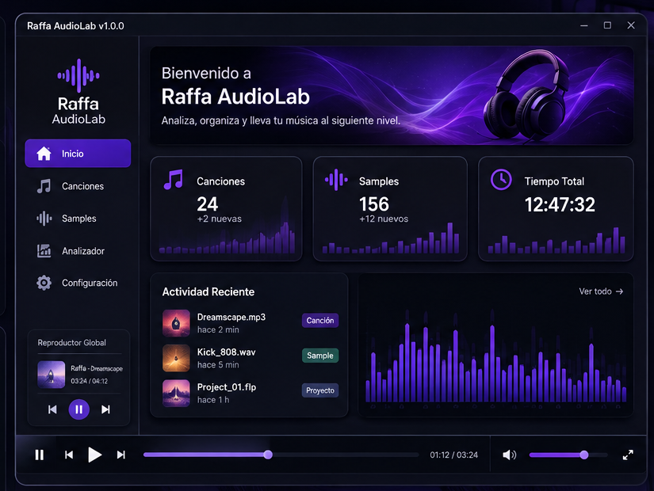
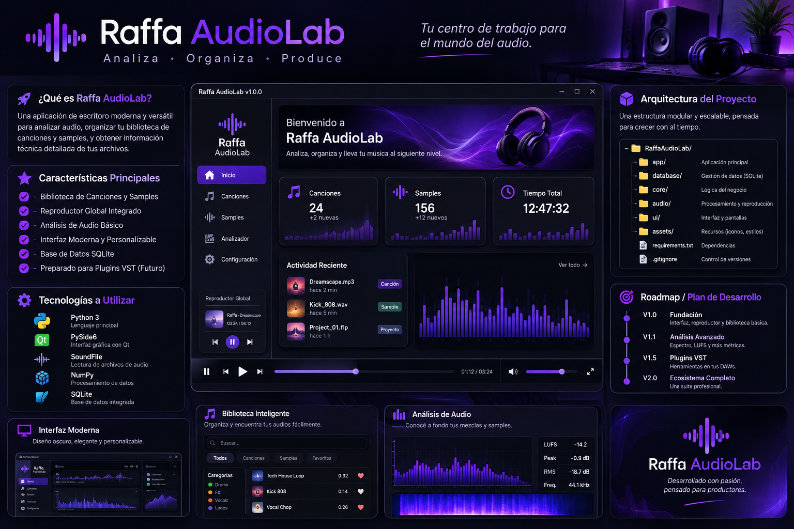

# 🎧 RAFFA AudioLab

**Gestor de bibliotecas de audio y analizador de sonido para productores musicales.**  
**Audio library manager and audio analyzer for music producers.**

<p align="center">
  
</p>

<p align="center">
  <em>Concepto visual de la interfaz · User interface concept</em>
</p>

---

# 🇦🇷 Español

## 📌 Sobre el proyecto

**Raffa AudioLab** es una aplicación de escritorio desarrollada con Python y PySide6, pensada para ayudar a productores musicales a organizar sus bibliotecas de audio, administrar samples, reproducir archivos y consultar información técnica del sonido.

El objetivo es crear una herramienta moderna, práctica y modular que reúna funciones útiles para el trabajo diario de producción musical.


### Arquitectura e información técnica

<p align="center">
  
</p>

*Diseño de arquitectura, tecnologías y organización del proyecto.*


## ✨ Funcionalidades

### Implementadas
- Interfaz de escritorio con tema oscuro.
- Menú lateral con navegación entre secciones.
- Reproductor de audio integrado.
- Controles de reproducción, pausa, anterior y siguiente.
- Barra de progreso y selección de archivos de audio.

### En desarrollo y planificación
- Biblioteca musical persistente con SQLite.
- Importación de archivos individuales y carpetas completas.
- Biblioteca de samples con categorías, búsqueda y favoritos.
- Consulta de metadatos de audio.
- Detección de archivos faltantes.
- Visualización de formas de onda y análisis de audio.

## 🛠️ Tecnologías

- **Python 3:** lógica de la aplicación.
- **PySide6:** interfaz gráfica.
- **Qt Multimedia:** reproducción de audio.
- **SQLite:** almacenamiento persistente planificado.
- **NumPy y SoundFile:** herramientas previstas para procesamiento y análisis de audio.

## 🚀 Instalación y ejecución

### Requisitos
- Python 3.
- pip.

### 1. Clonar el repositorio

```bash
git clone https://github.com/TU-USUARIO/Raffa-AudioLab.git
cd Raffa-AudioLab
```

### 2. Crear el entorno virtual

```bash
python -m venv venv
```

Activarlo en Windows PowerShell:

```powershell
.\venv\Scripts\Activate.ps1
```

### 3. Instalar las dependencias

```bash
pip install -r requirements.txt
```

### 4. Ejecutar la aplicación

```bash
python main.py
```

## 🗺️ Hoja de ruta

- [x] Interfaz inicial de escritorio.
- [x] Menú lateral y navegación.
- [x] Reproductor de audio básico.
- [ ] Integración con SQLite.
- [ ] Biblioteca musical persistente.
- [ ] Administración de samples.
- [ ] Audio Analyzer.
- [ ] Visualización avanzada de audio.

## 📍 Estado del proyecto

Raffa AudioLab se encuentra en una etapa inicial de desarrollo. Las funcionalidades, la arquitectura y la interfaz evolucionarán a medida que avance el proyecto.

## 👨‍💻 Autor

**Raffa** — Desarrollador independiente y productor musical.

---

# 🇬🇧 English

## 📌 About the Project

**Raffa AudioLab** is a desktop application built with Python and PySide6, designed to help music producers organize audio libraries, manage samples, play audio files, and inspect technical audio information.

The goal is to build a modern, practical, and modular tool that brings useful music production workflows together in one application.

## 🖥️ UI Concept and Architecture

The visual identity draws inspiration from professional music production software, featuring a dark interface, purple accents, and a clear navigation structure.

The following image presents the project's technical vision and proposed architecture.

## ✨ Features

### Implemented
- Dark desktop interface.
- Sidebar navigation between sections.
- Integrated audio player.
- Play, pause, previous, and next controls.
- Playback progress bar and audio file selection.

### Planned and in development
- Persistent music library powered by SQLite.
- Individual file and folder imports.
- Sample library with categories, search, and favorites.
- Audio metadata inspection.
- Missing-file detection.
- Waveform visualization and audio analysis.

## 🛠️ Tech Stack

- **Python 3:** application logic.
- **PySide6:** graphical user interface.
- **Qt Multimedia:** audio playback.
- **SQLite:** planned persistent storage.
- **NumPy and SoundFile:** planned audio processing and analysis.

## 🚀 Installation and Usage

### Requirements
- Python 3.
- pip.

### 1. Clone the repository

```bash
git clone https://github.com/YOUR-USERNAME/Raffa-AudioLab.git
cd Raffa-AudioLab
```

### 2. Create a virtual environment

```bash
python -m venv venv
```

Activate it in Windows PowerShell:

```powershell
.\venv\Scripts\Activate.ps1
```

### 3. Install dependencies

```bash
pip install -r requirements.txt
```

### 4. Run the application

```bash
python main.py
```

## 🗺️ Roadmap

- [x] Initial desktop interface.
- [x] Sidebar navigation.
- [x] Basic audio player.
- [ ] SQLite integration.
- [ ] Persistent music library.
- [ ] Sample management.
- [ ] Audio Analyzer.
- [ ] Advanced audio visualization.

## 📍 Project Status

Raffa AudioLab is in its early development stage. Features, architecture, and interface design will evolve as development progresses.

## 👨‍💻 Author

**Raffa** — Independent developer and music producer.

---

<p align="center">
  <em>Built with Python, driven by music.</em>
</p>
